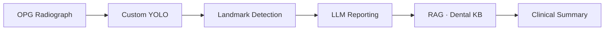

<div align="center">


# `raj@bitraj09:~$ whoami`

**Raj Ravindra Chavan** — building AI that ships to production, not just notebooks.

</div>

---

```bash
$ cat ./profile.json
{
  "role":        "AI/ML Engineer",
  "focus":       ["LLMs", "RAG", "Agentic AI", "Computer Vision", "MLOps"],
  "stack":       ["Python", "PyTorch", "TensorFlow", "FastAPI", "Docker", "Linux"],
  "currently":   "Production LLM systems & biomedical AI",
  "open_to":     ["AI/ML Roles", "GenAI Roles", "Research Collabs"],
  "status":      "building_in_public"
}
```

---

## `> ./what_i_build`

| Layer | I build |
|---|---|
| **🧠 GenAI / LLMs** | RAG pipelines, Agentic AI, prompt engineering, LangChain, LlamaIndex, fine-tuning, Hugging Face Transformers, OpenAI API |
| **👁️ Computer Vision** | Custom YOLO object detection, medical imaging, landmark detection, OpenCV, MediaPipe |
| **⚙️ MLOps / Prod ML** | End-to-end ML pipelines, Docker, CI/CD, FastAPI REST APIs, model deployment & versioning, AWS / GCP, Git, Linux |
| **📊 Data** | Cleaning, preprocessing, feature engineering, validation, outlier detection, Pandas, NumPy, SQL, MySQL, MongoDB, FAISS / Pinecone / ChromaDB |

<div align="center">


</div>

---

## `> ./flagship_project --dental-ai`

**Dental AI** — automated dental diagnostics, end to end.



- Custom YOLO model trained on OPG radiographs for landmark detection
- LLM layer auto-generates natural-language clinical summaries from detected landmarks
- RAG module grounds explanations in a curated dental knowledge base — fewer hallucinations, more factual reports

🔗 [Dental-AI-v2](https://github.com/bitraj09/Dental-AI-v2) · [Dentforhemant](https://github.com/bitraj09/Dentforhemant)

---

## `> ./featured_repos`

[](https://github.com/bitraj09/Dental-AI-v2)
[](https://github.com/bitraj09/datastraw-smart-roster)
[](https://github.com/bitraj09/supervised-learning)
[](https://github.com/bitraj09/server-load-balancer-)
[](https://github.com/bitraj09/stone-paper-scissors-game-)
[](https://github.com/bitraj09/auto-labeller-)

**Also on my stack:** House Price Prediction with CatBoost · Unsupervised Learning · Disk Analyzer · Flask OLAP app

---

## `> ./experience.log`

```text
2025-01 — 2025-04  AI/ML & Full Stack Intern @ Rudnesh Integrator Engineering Unlocked
                    └─ End-to-end ML pipelines for predictive analytics
                    └─ FastAPI + Docker APIs serving TensorFlow / PyTorch models
                    └─ CI/CD automation with Git & Linux for production ML

2024-01 — 2024-05  Cybersecurity Intern @ Tutelr
                    └─ Vulnerability assessments on production systems
                    └─ Offensive & defensive techniques for secure ML deployment

2023-06 — 2023-12  Mobile App Development Intern @ IOFT
                    └─ AI-enabled mobile apps, full SDLC
                    └─ Debugging, testing & REST API integration
```

---

## `> ./research --patent`

```text
[📄] PAPER   "Forensic Age Estimation Using AI" — Author
             Deep learning + computer vision for automated
             forensic age estimation from medical imaging.

[📜] PATENT  "OPG Landmarks Detection System" — Inventor
             AI-based automated landmark detection on
             orthopantomogram (OPG) dental radiographs.
```

---

## `> ./education`

```text
B.Tech, Information Technology — Bharati Vidyapeeth Deemed University · 2024–2027
Diploma, Information Technology — MSBTE · 2021–2024

Certifications: Certified Python Developer · Cybersecurity (Tutelr) · Mobile App Development
```

---

## `> ./trophies`

<div align="center">


</div>

---

## `> ./github_stats`

<div align="center">


</div>

---

## `> ./snake --eats_my_contributions`

<div align="center">


*The snake above is generated automatically every day — it eats my contributions.*

</div>

---

<div align="center">


```bash
$ ./connect.sh
> hiring for AI/ML, GenAI, or Computer Vision? let's talk.
> rajravindrachavan09@gmail.com  ·  bit-raj.tech
```

📍 Navi Mumbai, IN &nbsp;·&nbsp; 📧 rajravindrachavan09@gmail.com &nbsp;·&nbsp; 🌐 [bit-raj.tech](https://bit-raj.tech)

</div>


